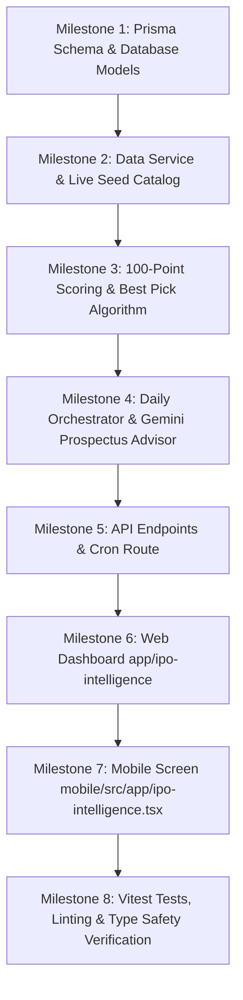

# NORTH IPO INTELLIGENCE: COMPLETE ENGINEERING SPECIFICATION & IMPLEMENTATION PLAN

## 1. Executive Summary & Mission

The goal of this project is to build **North IPO Intelligence**, an institutional-grade, quantitative, risk-controlled Initial Public Offering (IPO) recommendation engine that seamlessly integrates into the existing North Personal Financial Advisor system.

The engine answers three critical questions for the user every market day:
1. **Which Indian IPOs are currently OPEN for application today?**
2. **From all open IPOs, which single IPO is the absolute BEST to apply to (or should the user AVOID ALL)?**
3. **What is the recommended application strategy (Listing Gains vs. Long-Term Hold), what quantity/lot size is safe based on the user's personal financial phase, and what are the key prospectus risks?**

This system will be built with **strict dual-platform parity** across the Next.js 16 Web Application (`app/`) and the Expo React Native Mobile Application (`mobile/src/app/`), following the four-tier architecture and personal finance guardrails already established in the codebase.

---

## 2. Technical Audit of Existing Stock Intelligence Engine

The existing stock recommendation engine in North is organized around quantitative rigor, macro awareness, and personal capital protection:

| Layer / Service | Existing Path | Key Capabilities & Patterns to Reuse |
|---|---|---|
| **Market Data Layer** | `src/services/marketData/index.ts` | Yahoo Finance/NSE fetcher, IST timestamp parsing, candle deduplication, PostgreSQL persistence (`StockMarketBar`), provider health logging (`StockDataFetchLog`). |
| **Market Regime Engine** | `src/services/stockAnalysis/regime.ts` | Evaluates Nifty 50 benchmarks against 20/50/200-day SMAs and ATR volatility. Classifies market into `BULLISH`, `NEUTRAL`, `BEARISH`, `HIGH_VOLATILITY`, `DATA_UNRELIABLE`. Prevents new entries in hostile conditions. |
| **Personal Risk & Capital Allocation** | `src/services/stockRisk/index.ts` | Dynamically checks user's `FinancialProfile`, financial phase (`EF_BUILDING`, `CRISIS`, `GOAL_SPRINT`, `WEALTH_BUILDING`), enforces the 5% portfolio drawdown circuit breaker (`NORMAL`, `WARNING`, `RESTRICTED`, `HALTED`), and performs integer unit sizing. |
| **Quantitative Analysis & Scoring** | `src/services/stockAnalysis/scoring.ts` & `indicators.ts` | Multi-factor quantitative scoring (0-100) with deterministic weighting and transparent sub-scores. |
| **Strategy & Execution Rules** | `src/services/stockStrategy/index.ts` | Explicit entry price, target price, stop-loss calculation with mandatory Risk-Reward ($\ge 1.5$) and holding horizon specifications. |
| **AI Scout & Advisor Layer** | `src/services/stockRecommendations/aiScout.ts` & `aiAdvisor.ts` | Dual-role Gemini integration: (1) Discovery of catalyst candidates, (2) Generating plain-English, explainable rationales that present both pros and contra-arguments. |
| **Orchestration & Persistence** | `src/services/stockRecommendations/index.ts` | Orchestrates daily session runs, enforces zero forced trades, saves snapshots in `StockRecommendationRun` and `StockRecommendationItem`. |
| **Dual-Platform UIs** | `app/stock-intelligence/` & `mobile/src/app/stock-intelligence.tsx` | Synchronized full-featured UIs on Web and Mobile with tabbed layouts, status indicators, and paper execution. |

---

## 3. IPO Domain Mechanics vs. Secondary Equities

Unlike secondary cash equities, IPOs possess unique market dynamics that require specialized analysis:

```
┌─────────────────────────────────────────────────────────────────────────────┐
│                       SECONDARY EQUITIES (Existing)                         │
│  • Historical price candles available (50–200+ days)                        │
│  • Indicators: Moving Averages, RSI, MACD, Bollinger Bands, ATR             │
│  • Strategy: Technical swing trading (2–15 days holding period)             │
│  • Risk Management: Trailing stop-loss, profit target price                 │
└─────────────────────────────────────────────────────────────────────────────┘
                                      vs
┌─────────────────────────────────────────────────────────────────────────────┐
│                         PRIMARY MARKET / IPOS (New)                         │
│  • NO historical market bars on the exchange                                │
│  • Time-bound Bidding Window (typically 3 business days, 10:00 - 17:00 IST) │
│  • Fixed Price Band (Floor to Cap price, e.g., ₹450 - ₹475)                 │
│  • Fixed Lot Size (e.g., 30 shares = ₹14,250 min retail lot)                │
│  • Multi-Category Bidding Demand: QIB (50%), NII/HNI (15%), Retail (35%)    │
│  • Grey Market Premium (GMP): Unofficial listing premium proxy in ₹ and %   │
│  • Fundamental Metrics: P/E vs Listed Peers, Revenue Growth, PAT Margin     │
│  • Prospectus Structure: Fresh Issue (growth/debt) vs OFS (promoter exit)   │
│  • Strategy: Listing Day Pop vs Long-Term Compounder vs Avoid               │
└─────────────────────────────────────────────────────────────────────────────┘
```

### Key Drivers of IPO Listing Success in India
1. **Institutional Demand (QIB Subscription)**: Qualified Institutional Buyers (mutual funds, foreign portfolio investors, insurance companies) conduct deep due diligence. High QIB oversubscription ($\ge 5x$ on Day 2/Day 3) is the strongest statistical predictor of positive listing returns.
2. **Grey Market Premium (GMP) & Trend**: GMP indicates pre-listing sentiment and market appetite. A rising GMP percentage ($> 20\%$) signals strong listing pop potential; a flat or decaying GMP warns of high listing downside.
3. **Valuation relative to Listed Peers**: Aggressively priced issues leaving "nothing on the table for investors" frequently list at a discount, even with reputable promoter pedigree.
4. **Issue Objective (Fresh vs OFS)**: Higher proportion of Fresh Issue ($> 50\%$) implies capital staying inside the business to pay down high-cost debt or fund capital expenditures. Pure 100% OFS (Offer for Sale) indicates existing private equity/promoters cashing out.
5. **SEBI Retail Allotment Math**: In oversubscribed retail categories, allotment is conducted via randomized lottery for 1 minimum lot per unique PAN. Therefore, the optimal retail bidding strategy is **bidding at Cut-Off price for 1 lot**, rather than applying for multiple lots under a single PAN.

---

## 4. "Best IPO to Apply Today" Ranking & Scoring Algorithm

When multiple IPOs are open simultaneously on a given date, the engine runs every open candidate through a deterministic 100-point composite scoring model:

$$\text{Total IPO Score} = S_{\text{Demand}} (35\%) + S_{\text{GMP}} (30\%) + S_{\text{Valuation}} (20\%) + S_{\text{IssueQuality}} (15\%)$$

### Sub-Score Formulations

#### 1. Institutional & Subscription Demand Score ($S_{\text{Demand}}$, Max 35 pts)
- **QIB Subscription Multiple**:
  - $\ge 15x$: 20 pts
  - $5x - 14.9x$: 15 pts
  - $2x - 4.9x$: 10 pts
  - $1x - 1.9x$: 6 pts
  - $< 1x$ (undersubscribed by institutions): 0 pts
- **Overall Total Subscription**:
  - $\ge 20x$: 10 pts
  - $5x - 19.9x$: 7 pts
  - $1.5x - 4.9x$: 4 pts
  - $< 1x$: 0 pts
- **Day Momentum Bonus**: Day 2/Day 3 acceleration bonus (+5 pts if subscription grew $> 2.5x$ day-over-day).

#### 2. Grey Market Premium (GMP) & Sentiment Score ($S_{\text{GMP}}$, Max 30 pts)
- **Estimated Listing Gain % ($\text{GMP} / \text{PriceCap} \times 100$)**:
  - $\ge 40\%$: 20 pts (exceptional listing interest)
  - $20\% - 39.9\%$: 15 pts (strong listing interest)
  - $10\% - 19.9\%$: 10 pts (moderate interest)
  - $0\% - 9.9\%$: 3 pts (low/negligible interest)
  - Negative GMP: $-15$ pts penalty (high probability of listing discount)
- **GMP Trend**:
  - `RISING`: +10 pts
  - `STABLE`: +5 pts
  - `FALLING`: 0 pts (warning sign of fading enthusiasm)

#### 3. Fundamentals & Valuation Score ($S_{\text{Valuation}}$, Max 20 pts)
- **P/E Discount vs Peer Industry Average**:
  - P/E $\ge 20\%$ lower than industry median: 8 pts (undervalued)
  - P/E within $\pm 20\%$ of industry median: 5 pts (fairly priced)
  - P/E $> 20\%$ higher than industry median: 1 pt (priced to perfection)
  - Loss-making company (negative EPS) with non-tech business: 0 pts
- **Profitability & RoNW**:
  - RoNW $\ge 15\%$ and PAT margin $\ge 10\%$: 7 pts
  - RoNW $8\% - 14.9\%$: 4 pts
  - Low or negative return ratios: 1 pt
- **Revenue CAGR (3-Year)**:
  - CAGR $> 20\%$: 5 pts
  - CAGR $10\% - 20\%$: 3 pts
  - CAGR $< 10\%$: 1 pt

#### 4. Issue Structure & Governance Score ($S_{\text{IssueQuality}}$, Max 15 pts)
- **Fresh Issue vs OFS Proportion**:
  - Fresh Issue $\ge 60\%$: 6 pts
  - Fresh Issue $30\% - 59\%$: 3 pts
  - Pure OFS ($100\%$ OFS): 0 pts
- **Balance Sheet Debt-to-Equity**:
  - Debt/Equity $< 0.5$: 5 pts
  - Debt/Equity $0.5 - 1.2$: 3 pts
  - Debt/Equity $> 1.2$: 0 pts
- **Anchor Book Quality**:
  - Tier-1 institutional anchors present (Marquee domestic MFs, GIC, ADIA, sovereign funds): 4 pts
  - Standard/untested anchor book: 2 pts

---

### Conviction Verdict & Action Matrix

Based on the total score and safety conditions:

| Total Score | Verdict | Recommendation Action | Suggested Strategy |
|---|---|---|---|
| **$\ge 75$** | **STRONG APPLY** | ⭐ **Best Pick to Apply Today** | Apply at Cut-Off Price (1 Lot per PAN) for strong listing gains & potential long-term hold |
| **$60 - 74$** | **APPLY (GOOD)** | Viable candidate | Apply for Listing Gains (target exit on listing day) |
| **$45 - 59$** | **MAYBE / NEUTRAL** | Low conviction | Only for aggressive/high-risk accounts; avoid for conservative profiles |
| **$< 45$** | **AVOID** | Do Not Apply | High risk of listing loss or capital lock-in; avoid |

### The "Zero Forced Trade" Guardrail for IPOs:
If multiple IPOs are open today, but **none of them achieve a score of $\ge 60$**, the engine will explicitly report:
> **"AVOID ALL OPEN IPOS TODAY: None of the currently open issues meet North's safety and risk-adjusted return thresholds."**
The engine will never pick a substandard IPO just to have a recommendation on screen.

---

## 5. Personal Finance & Capital Guardrails Integration

The IPO engine directly connects with the user's `FinancialProfile` through `src/services/stockRisk/`:

1. **Financial Phase Gate**:
   - `CRISIS`: IPO applications strictly blocked. All capital reserved for stabilization.
   - `EF_BUILDING`: IPO applications blocked or warned unless emergency fund has at least 3 months of core expenses funded.
   - `GOAL_SPRINT` / `WEALTH_BUILDING`: Permitted to allocate unencumbered surplus funds.
2. **Capital Check for 1 Retail Lot**:
   - The typical minimum retail lot in India requires **₹14,000 – ₹15,000**.
   - Sizing logic checks: $\text{Eligible Surplus} \ge \text{LotSize} \times \text{PriceCap}$.
   - If available surplus $< \text{MinInvestment}$, the engine informs the user: *"Insufficient unallocated surplus (₹X available, ₹14,250 required for 1 lot). Application deferred to preserve liquid reserves."*
3. **Application Sizing Rules**:
   - Retail Category: Recommend exactly **1 Lot (at Cut-Off Price)** per PAN application. Applying for 2 or 3 lots in an oversubscribed retail IPO provides zero additional allotment advantage under SEBI rules and only locks up liquidity.
   - High Net Worth (sHNI: ₹2–10 Lakhs, bHNI: $> ₹10$ Lakhs): Sizing recommendations tailored for HNI categories only when explicitly configured.

---

## 6. Database Schema & Prisma Architecture

New models to add in `prisma/schema.prisma` without altering existing tables:

```prisma
/// Mainboard and SME IPO listings tracked by the engine
model IpoListing {
  id                  String   @id @default(cuid())
  companyName         String
  symbol              String   @unique
  exchange            String   @default("NSE") // NSE, BSE, BOTH
  issueType           String   @default("MAINBOARD") // MAINBOARD, SME
  
  // Timeline dates (in IST)
  openDate            DateTime @db.Date
  closeDate           DateTime @db.Date
  allotmentDate       DateTime? @db.Date
  refundsDate         DateTime? @db.Date
  dematCreditDate     DateTime? @db.Date
  listingDate         DateTime? @db.Date
  
  // Issue Pricing and Sizing
  priceFloor          Float
  priceCap            Float
  lotSize             Int
  minInvestment       Float    // priceCap * lotSize
  issueSizeCr         Float    // In INR Crores
  freshIssueCr        Float    @default(0)
  ofsCr               Float    @default(0)
  
  // Live / Latest Demand & Sentiment
  gmpAmount           Float    @default(0)
  gmpPercent          Float    @default(0) // (gmpAmount / priceCap) * 100
  gmpTrend            String   @default("STABLE") // RISING, STABLE, FALLING
  qibSub              Float    @default(0) // Subscription multiple (e.g., 14.5x)
  niiSub              Float    @default(0)
  retailSub           Float    @default(0)
  totalSub            Float    @default(0)
  
  // Financial & Valuation Metrics
  peRatio             Float?
  industryPe          Float?
  revenueGrowthPct    Float?   // 3-year CAGR
  patMarginPct        Float?
  ronwPct             Float?
  debtToEquity        Float?
  
  // Status and Meta
  status              String   @default("UPCOMING") // UPCOMING, OPEN, CLOSED, ALLOTTED, LISTED
  listingPrice        Float?   // Actual price on listing day
  listingGainPct      Float?   // Actual listing day return %
  rhpUrl              String?  // Link to Red Herring Prospectus PDF
  summaryThesis       String?  // Business overview & industry position
  keyRisks            String   @default("[]") // JSON array of prospect risks
  
  createdAt           DateTime @default(now())
  updatedAt           DateTime @updatedAt
  
  recommendationItems IpoRecommendationItem[]
  applications        IpoApplicationRecord[]

  @@index([status])
  @@index([openDate, closeDate])
}

/// Daily IPO recommendation execution record (one per session date)
model IpoRecommendationRun {
  id                   String   @id @default(cuid())
  sessionDate          DateTime @db.Date @unique
  marketRegime         String   // Passed from stock regime (BULLISH, NEUTRAL, etc.)
  totalOpenIpos        Int      @default(0)
  bestIpoSymbol        String?  // Symbol of the #1 Best Pick to Apply Today
  bestIpoVerdict       String?  // STRONG_APPLY, AVOID_ALL, etc.
  aiSynthesis          String?  // Overall daily IPO market commentary by Gemini
  status               String   @default("COMPLETE")
  createdAt            DateTime @default(now())
  updatedAt            DateTime @updatedAt
  
  items                IpoRecommendationItem[]

  @@index([sessionDate])
}

/// Individual IPO recommendation details within a daily run
model IpoRecommendationItem {
  id                   String   @id @default(cuid())
  runId                String
  run                  IpoRecommendationRun @relation(fields: [runId], references: [id], onDelete: Cascade)
  ipoId                String
  ipo                  IpoListing @relation(fields: [ipoId], references: [id], onDelete: Cascade)
  symbol               String
  
  isBestPick           Boolean  @default(false)
  score                Float    // 0 to 100 composite score
  verdict              String   // STRONG_APPLY, APPLY, NEUTRAL, AVOID
  strategy             String   // LISTING_GAINS, LONG_TERM, AVOID
  expectedListingGain  Float    // Expected percentage gain
  
  // Component sub-scores
  demandScore          Float
  gmpScore             Float
  valuationScore       Float
  issueQualityScore    Float
  
  // Sizing & Action details
  recommendedLots      Int      @default(1)
  recommendedBidPrice  Float    // Cut-off price
  requiredCapital      Float    // priceCap * recommendedLots
  userCanAfford        Boolean  @default(true)
  
  // Qualitative AI audit
  reasonsFor           String   @default("[]") // JSON array
  reasonsAgainst       String   @default("[]") // JSON array
  aiThesis             String?
  
  createdAt            DateTime @default(now())

  @@index([runId])
  @@index([ipoId])
}

/// User's tracked IPO applications (Virtual / Paper or Real tracking)
model IpoApplicationRecord {
  id                   String   @id @default(cuid())
  ipoId                String
  ipo                  IpoListing @relation(fields: [ipoId], references: [id], onDelete: Cascade)
  symbol               String
  lotsApplied          Int      @default(1)
  bidPrice             Float
  totalAmountBlocked   Float
  upiIdUsed            String?
  applicationNumber    String?
  applicationDate      DateTime @default(now())
  
  // Status workflow
  status               String   @default("APPLIED") // APPLIED, ALLOTTED, NOT_ALLOTTED, WITHDRAWN
  lotsAllotted         Int      @default(0)
  listingExitPrice     Float?
  realizedPnl          Float?
  notes                String?
  
  createdAt            DateTime @default(now())
  updatedAt            DateTime @updatedAt

  @@index([ipoId])
  @@index([status])
}
```

---

## 7. Domain Services Architecture (`src/services/ipo*`)

```
src/services/
├── ipoData/
│   ├── index.ts                # Primary fetcher, catalog manager, live seed data
│   └── types.ts                # TypeScript definitions for IPOs, subscriptions, and GMP
├── ipoAnalysis/
│   ├── scoring.ts              # 100-point composite scoring & best pick algorithm
│   └── valuation.ts            # P/E comparison, RoNW, balance sheet debt checks
└── ipoRecommendations/
    ├── index.ts                # Daily orchestrator & capital allocation integration
    └── aiIpoAdvisor.ts         # Gemini AI Prospectus & Red-Flag Audit Engine
```

### Module Responsibilities:
1. **`src/services/ipoData/index.ts`**:
   - Collects and persists Mainboard and SME IPO details.
   - Maintains catalog of Open, Upcoming, Closed, and Listed IPOs.
   - Calculates and synchronizes dates against current IST time.
   - Includes reliable fallback mock-data generator with real Indian market listings (e.g., Hyundai Motor India, Swiggy, Waaree Energies, Afcons Infrastructure, NTPC Green) to guarantee zero-failure local operation when external financial scrapers encounter CORS/rate-limits.
2. **`src/services/ipoAnalysis/scoring.ts`**:
   - Pure, deterministic, testable calculation functions:
     - `calculateDemandScore(sub: SubscriptionStatus): number`
     - `calculateGmpScore(gmp: GmpInfo, priceCap: number): number`
     - `calculateValuationScore(fin: FinancialMetrics): number`
     - `calculateIssueQualityScore(issue: IssueDetails): number`
     - `calculateCompositeIpoScore(ipo: IpoListing): IpoScoreBreakdown`
   - Deterministic tie-breaker logic to select the undisputed **#1 Best Pick** among multiple open candidates.
3. **`src/services/ipoRecommendations/index.ts`**:
   - Checks active market session date in IST.
   - Fetches current Macro Regime from `detectMarketRegime()`.
   - Fetches Personal Capital Allocation from `calculateCapitalAllocation()`.
   - Filters all IPOs where: $\text{openDate} \le \text{today} \le \text{closeDate}$.
   - Computes composite scores and tags the highest scoring IPO as `isBestPick = true` (or sets verdict to `AVOID_ALL` if highest score $< 60$).
   - Calls `aiIpoAdvisor.ts` to enrich the recommendation with an institutional thesis.
   - Persists execution into `IpoRecommendationRun` and `IpoRecommendationItem`.
4. **`src/services/ipoRecommendations/aiIpoAdvisor.ts`**:
   - Feeds IPO prospectus financials, peer P/E, OFS ratio, and subscription stats into Gemini.
   - Produces structured output: business overview, competitive moat, top 3 strengths, top 3 red-flag risks, and final application verdict.

---

## 8. API Specification (`app/api/ipo-intelligence/`)

| Endpoint | Method | Description |
|---|---|---|
| `/api/ipo-intelligence/recommendations` | `GET` | Returns today's active recommendation run, including the **#1 Best Pick to Apply Today**, all currently open IPOs, upcoming IPOs, and closed issues. |
| `/api/ipo-intelligence/run` | `POST` | Manually triggers or forces a fresh execution of the daily IPO recommendation pipeline. |
| `/api/ipo-intelligence/catalog` | `GET` | Fetches the complete catalog of IPOs with filter parameters (`status`: OPEN, UPCOMING, CLOSED, LISTED; `type`: MAINBOARD, SME). |
| `/api/ipo-intelligence/apply` | `POST` | Records a new user application (lot count, blocked capital, UPI ID) for portfolio tracking. |
| `/api/ipo-intelligence/apply` | `GET` | Fetches the user's active and historical IPO applications with PnL. |
| `/api/cron/ipo-intelligence` | `GET` | Vercel Cron endpoint scheduled every weekday at 09:30 AM IST (bidding market open). |

---

## 9. Web Application Interface (`app/ipo-intelligence/`)

Built using Next.js 16 App Router, Tailwind CSS, Lucide icons, and TanStack Query.

### Layout & Component Structure:
1. **Header & Status Bar**:
   - Current IST Date & Session Status (Market Open / Closed).
   - Market Regime Pill (e.g., `BULLISH` / `NEUTRAL`).
   - Personal Deployable Surplus badge (e.g., `Deployable: ₹42,500`).
   - "Refresh Pipeline" button with loading spinner.
2. **Featured Hero Card: "BEST IPO TO APPLY TODAY"**:
   - Glowing accent border indicating high-conviction status.
   - Prominent badge: ⭐ **TOP PICK TO APPLY TODAY** (or warning alert if **AVOID ALL**).
   - Company Name, Symbol, and Mainboard/SME tag.
   - Expected Listing Gain Badge: e.g., `+38.5% (Est. Profit: ₹5,750 / lot)`.
   - Subscription Progress Meter:
     - QIB: `14.2x` (Green progress bar)
     - NII/HNI: `8.5x` (Blue progress bar)
     - Retail: `4.1x` (Purple progress bar)
     - Total: `9.4x`
   - Application Essentials Grid:
     - Price Band: `₹475 - ₹500` (Bid at Cut-Off ₹500)
     - Lot Size: `30 shares`
     - Minimum Capital: `₹15,000`
     - Bidding Window: `Closes Tomorrow, 5:00 PM IST`
   - Gemini AI Thesis & Red-Flag Box: Strengths, Moat, and Key Contra Risks.
   - "Mark as Applied" interactive button.
3. **Tabbed Navigation**:
   - **Tab 1: Open IPOs (N)**: Side-by-side comparative cards of all open IPOs with composite score badges and quick action buttons.
   - **Tab 2: Upcoming Pipeline (N)**: Timeline view of forthcoming IPOs with tentative price bands, issue sizes, and RHP links for advance capital planning.
   - **Tab 3: Past Listing Tracker (N)**: Historical performance table showing engine recommendation vs. actual listing day return (e.g., Recommended `STRONG_APPLY` $\rightarrow$ Listed at $+44\%$).
   - **Tab 4: My Applications**: User tracker for applied lots, blocked amount, allotment result, and realized profit on listing.
4. **Navigation Integration**:
   - Add **IPO Intelligence** link in `app/components/Sidebar.tsx` with `Layers` or `Flame` icon.

---

## 10. Mobile Application Interface (`mobile/src/app/ipo-intelligence.tsx`)

Following the Mandatory Dual-Platform Requirement (Rule 1):

1. **Routing & Framework**:
   - Create screen at `mobile/src/app/ipo-intelligence.tsx`.
   - Register in `mobile/src/app/_layout.tsx` under the main investment stack.
   - Add entry tile in `mobile/src/app/investments.tsx` ("IPO Intelligence: Daily Best Picks").
2. **Mobile Screen Layout**:
   - SafeAreaView with custom header, back button, and session indicator.
   - Pull-to-refresh (`RefreshControl`) and haptic feedback.
   - **Hero Card**:
     - Compact mobile layout of the **#1 Best Pick to Apply Today**.
     - Color-coded badges for GMP percentage, QIB multiple, and investment amount.
     - Expandable accordion for AI Thesis & Red Flags.
   - **Segmented Tab Bar**:
     - `Open (N)`, `Upcoming (N)`, `Performance`, `My Bids`.
   - **Application Modal**:
     - Quick modal to record lot count, calculate total blocked amount, and save application status.
3. **Design Aesthetics**:
   - Seamless dark-mode styling utilizing theme tokens (`#0a0a0c`, `#13141a`, `#22c55e`, `#3b82f6`).
   - Currency formatting via `formatCurrencyAmount` and `useCurrency()`.
   - Zero layout shifts, accessible tap targets ($\ge 44\times44$ px).

---

## 11. Testing & Quality Assurance Plan

### 1. Vitest Unit Test Suites
- **`src/services/ipoAnalysis/scoring.test.ts`**:
  - Test composite score computation across high, medium, and low subscription multiples.
  - Test negative GMP penalty and trend adjustments.
  - Test valuation discounts vs. premiums relative to industry averages.
  - Test pure OFS penalty vs. fresh issue bonus.
- **`src/services/ipoRecommendations/ipoRecommendations.test.ts`**:
  - Test scenario where multiple IPOs are open: verifies the higher-scoring issue is crowned `isBestPick`.
  - Test "Zero Forced Trade": when all open IPOs score $< 60$, verifies engine returns `AVOID_ALL`.
  - Test date boundaries: confirms only IPOs where $\text{openDate} \le \text{today} \le \text{closeDate}$ are evaluated as open.
  - Test capital deficit: verifies engine flags `userCanAfford = false` when deployable cash $< \text{priceCap} \times \text{lotSize}$.

### 2. Strict Quality Checks (Rule 5 & 6)
- **TypeScript**: `npx tsc --noEmit` must report **0 diagnostics errors**.
- **ESLint**: `npm run lint` must pass with **0 errors and 0 warnings**.
- **Vitest**: `npm run test` must pass all test files without regressions.

---

## 12. Execution Roadmap & Milestones



- **Milestone 1**: Update `prisma/schema.prisma` with `IpoListing`, `IpoRecommendationRun`, `IpoRecommendationItem`, and `IpoApplicationRecord`. Run `npx prisma generate`.
- **Milestone 2**: Build `src/services/ipoData/` with full type interfaces, Indian market seed catalog (Hyundai, Swiggy, Waaree, NTPC Green, etc.), and date filtering utilities.
- **Milestone 3**: Build `src/services/ipoAnalysis/` implementing the 100-point composite scoring formula and tie-breaker logic.
- **Milestone 4**: Build `src/services/ipoRecommendations/` with personal finance capital validation, zero-forced-trade safety, and `aiIpoAdvisor.ts`.
- **Milestone 5**: Implement API routes (`app/api/ipo-intelligence/recommendations`, `run`, `apply`, `catalog`) and cron job.
- **Milestone 6**: Build Web UI (`app/ipo-intelligence/page.tsx`, `IpoIntelligenceClient.tsx`) and add to sidebar navigation.
- **Milestone 7**: Build Mobile UI (`mobile/src/app/ipo-intelligence.tsx`), register in `_layout.tsx`, and add entry card.
- **Milestone 8**: Write Vitest unit tests, run `npm run lint` (0 errors, 0 warnings), and `npx tsc --noEmit` (0 errors).
